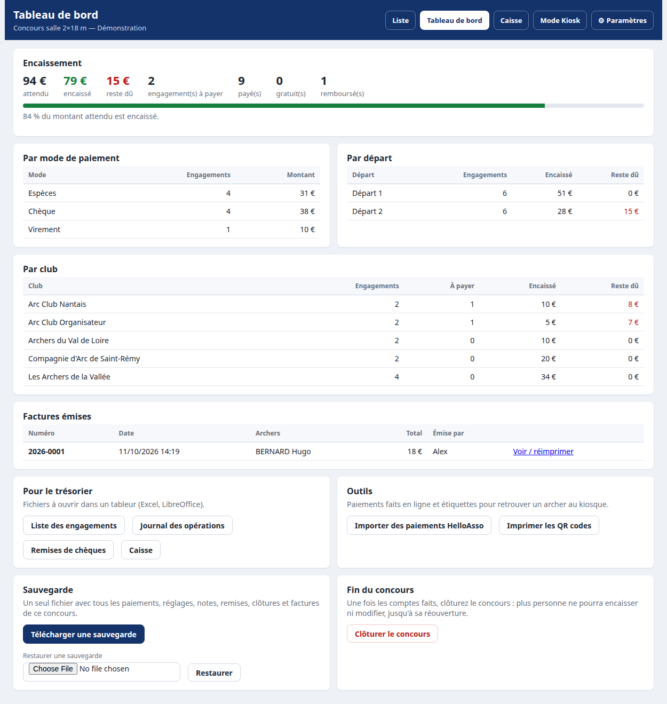
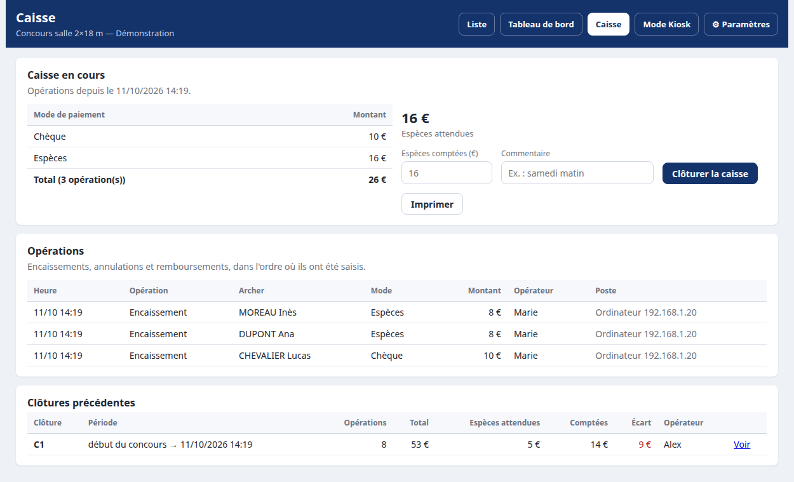

  

  
  
  

  <strong>Qui a payé ? Combien reste-t-il à encaisser ? Où en est la remise de chèques ?</strong> 
  RegistrArc répond à ces questions pendant toute la compétition, à l'ordinateur comme sur téléphone.

  <a href="#installer-le-module">Installer</a> ·
  <a href="#régler-les-tarifs-et-les-paiements">Régler les tarifs</a> ·
  <a href="#pendant-le-concours">Encaisser</a> ·
  <a href="#la-caisse">Caisse</a> ·
  <a href="#le-tableau-de-bord">Tableau de bord</a> ·
  <a href="#faire-une-facture">Factures</a> ·
  <a href="#questions-fréquentes">Questions</a>

 

## Aperçu

  

<table>
  <tr>
    <td align="center" valign="top" width="36%">
       
      <strong>Encaisser sur téléphone</strong>
    </td>
    <td align="center" valign="top" width="64%">
       
      <strong>Imprimer une facture</strong>
        
       
      <strong>Déposer les chèques</strong>
    </td>
  </tr>
</table>

<table>
  <tr>
    <td align="center" valign="top" width="50%">
       
      <strong>Suivre le concours</strong>
    </td>
    <td align="center" valign="top" width="50%">
       
      <strong>Clôturer la caisse</strong>
    </td>
  </tr>
</table>

## Ce que fait RegistrArc

<table>
  <tr>
    <td width="50%" valign="top">
      <strong>La liste des inscrits</strong> 
      Tous les archers du concours, avec ce que chacun doit payer pour chacun de ses départs.
    </td>
    <td width="50%" valign="top">
      <strong>L'encaissement</strong> 
      À l'ordinateur ou sur téléphone, en espèces, chèque, virement… et le remboursement d'un archer qui se désiste.
    </td>
  </tr>
  <tr>
    <td valign="top">
      <strong>La caisse</strong> 
      Chaque opération est notée (qui, quand, sur quel appareil). Clôture de caisse avec comptage des espèces.
    </td>
    <td valign="top">
      <strong>Les chèques</strong> 
      Un seul chèque pour plusieurs archers, bordereau de remise, suivi des remises déjà déposées.
    </td>
  </tr>
  <tr>
    <td valign="top">
      <strong>Les tarifs du club</strong> 
      Jeunes ou adultes, club organisateur ou non, départs supplémentaires, tarifs spéciaux, plafond, inscription tardive.
    </td>
    <td valign="top">
      <strong>Les factures</strong> 
      Numérotées (2026-0001, 2026-0002…), prêtes à imprimer ou à envoyer en PDF, réimprimables à l'identique.
    </td>
  </tr>
  <tr>
    <td valign="top">
      <strong>Le tableau de bord</strong> 
      Encaissé, reste dû, répartition par mode, départ et club. Fichiers pour le trésorier, sauvegarde.
    </td>
    <td valign="top">
      <strong>Les paiements en ligne</strong> 
      Import des paiements HelloAsso, et QR codes pour retrouver un archer au kiosque.
    </td>
  </tr>
</table>

RegistrArc ne modifie jamais les inscriptions dans I@nseo : il les lit et garde ses propres informations à part.

## Le greffe en 4 étapes

| | Quand | Quoi faire |
|:-:|---|---|
| **1** | Une fois pour toutes | [Installer le module](#installer-le-module) |
| **2** | Avant le concours | [Régler les tarifs et les modes de paiement](#régler-les-tarifs-et-les-paiements) |
| **3** | Pendant le concours | Encaisser [à l'ordinateur](#encaisser-à-lordinateur) ou [sur un téléphone](#encaisser-sur-un-téléphone) |
| **4** | Après le concours | [Clôturer la caisse](#la-caisse), [faire les factures](#faire-une-facture), [déposer les chèques](#préparer-la-remise-de-chèques), puis [clôturer le concours](#le-tableau-de-bord) |

> [!TIP]
> Dans la suite, cliquez sur un titre pour ouvrir la partie correspondante.

---

## Installer le module

<strong>Installer RegistrArc et donner les bons accès</strong>

 

1. Copiez le dossier **RegistrArc** dans le dossier **Modules/Custom** de votre I@nseo.
2. Ouvrez un concours dans I@nseo : RegistrArc apparaît dans le menu **Participants → Greffe**.
3. Si un message indique que le module ne peut pas enregistrer ses informations, voir les [questions fréquentes](#questions-fréquentes).

**Qui peut faire quoi ?**

| Action | Qui peut la faire |
|---|---|
| Voir le menu Greffe et consulter les pages | les personnes qui ont accès aux participants dans I@nseo |
| Encaisser, modifier les tarifs | les personnes qui peuvent modifier les participants |
| Installer une mise à jour du module | l'administrateur d'I@nseo |

Une personne qui a seulement le droit de consulter voit toutes les pages, mais les boutons pour encaisser ou modifier n'apparaissent pas.

## Régler les tarifs et les paiements

À faire avant chaque concours : dans la liste des engagements, cliquez sur **⚙ Paramétrer tarifs & paiements**. Les réglages sont propres à chaque concours.

> [!IMPORTANT]
> Pensez à cliquer sur **Enregistrer les paramètres** en bas de la page.

<strong>Jeunes et adultes</strong>

 

Les catégories du concours sont rangées en deux colonnes : **Jeunes** à gauche, **Adultes** à droite. Pour en changer une de colonne, faites-la glisser ou cliquez sur sa flèche.

Au départ, toutes les catégories en dessous de U21 (U11, U13, U15, U18) sont rangées dans les Jeunes ; U21 et les seniors dans les Adultes.

<strong>Prix des inscriptions</strong>

 

Pour les archers du club organisateur et pour ceux des autres clubs, jeunes et adultes, vous indiquez :

- le prix du **1er départ** ;
- le **supplément** à payer pour **chaque** départ en plus.

Exemple avec les prix proposés au départ :

| Archer | 1 départ | 2 départs | 3 départs |
|---|:-:|:-:|:-:|
| Jeune d'un autre club (8 € puis 6 €) | 8 € | 14 € | 20 € |
| Adulte d'un autre club (10 € puis 8 €) | 10 € | 18 € | 26 € |
| Adulte du club organisateur (5 € puis 5 €) | 5 € | 10 € | 15 € |

Le club organisateur est celui indiqué dans les informations du concours, dans I@nseo. Les départs d'un même archer sont reconnus grâce à son numéro de licence.

<strong>Cas particuliers : tarif découverte, finales, gratuité…</strong>

 

Les **règles** donnent un prix spécial à certains archers. Pour chaque règle, vous indiquez :

- un **nom**, qui s'affiche dans la liste et sur la facture (par exemple « Tarif découverte U11 ») ;
- **ce que la règle regarde** et la **valeur** à reconnaître ;
- le **prix** à appliquer ;
- si elle est **active** (décochez pour la mettre de côté sans la supprimer).

| La règle regarde… | Elle s'applique quand… | Exemple |
|---|---|:-:|
| Catégorie | la catégorie de l'archer contient la valeur | `U11` |
| Région | le numéro du club commence par ces 2 chiffres | `10` |
| Département | le numéro du club contient ces chiffres en 3e et 4e position | `69` |
| Qualification individuelle ou par équipe | l'archer y participe (`OUI`) ou non (`NON`) | `OUI` |
| Finale individuelle, par équipe, double mixte | pareil ; proposé seulement si le concours a ces finales | `OUI` |

À savoir :

- le prix d'une règle **remplace** le prix normal ;
- si plusieurs règles concernent le même archer, leurs prix **s'ajoutent** ;
- une règle à **0 €** rend l'inscription gratuite.

<strong>Plafond par archer et inscription tardive</strong>

 

Dans la partie **Réductions et majorations** des réglages (laisser à 0 pour ne pas s'en servir) :

- **Plafond par archer** : un archer ne paie jamais plus que ce montant pour l'ensemble de ses départs.
- **Majoration inscription tardive** : un supplément ajouté aux départs marqués « inscription tardive » dans la liste des engagements (bouton ✎ de la ligne).

Le plafond s'applique d'abord, la majoration ensuite : un archer en retard paie toujours sa majoration.

<strong>Modes de paiement et inscriptions gratuites</strong>

 

Espèces, Chèque, Virement et Gratuit sont proposés au départ. Vous pouvez en ajouter (par exemple Carte bancaire) ou les renommer. Seuls les paiements par **chèque** apparaissent sur la remise de chèques.

**Inscriptions gratuites** : quand le prix d'une inscription est de 0 €, l'archer n'a rien à payer. RegistrArc l'affiche « Gratuit » et ne le compte pas parmi les archers à encaisser : il n'y a rien à valider.

<strong>Reprendre les réglages d'un autre concours</strong>

 

En haut de la page des réglages :

- **Exporter** enregistre tous vos réglages dans un fichier ;
- **Importer** les recharge, par exemple pour reprendre les tarifs de l'an dernier ou les mettre sur un autre ordinateur.

Avant de remplacer vos réglages, RegistrArc vous prévient si le fichier vient d'un autre concours ou s'il est plus ancien que vos réglages actuels.

## Pendant le concours

### Encaisser à l'ordinateur

<strong>La liste des engagements</strong>

 

C'est l'écran principal (voir l'aperçu en haut de cette page). Chaque ligne est un départ d'un archer : licence, nom, club, catégorie, départ, cible, montant et état du paiement.

- **Chercher un archer** : par club, catégorie, départ, état du paiement (payés, non payés, gratuits) ou en tapant un nom, une licence, un club. **Réinitialiser** remet tout à zéro.
- **Trier** : cliquez sur le titre d'une colonne ; cliquez à nouveau pour inverser l'ordre.
- **Repères** : « Archer non affecté » signale un archer sans cible ; une étiquette violette indique un prix spécial.

<strong>Encaisser un ou plusieurs archers</strong>

 

- **Un archer** : sur sa ligne, choisissez le mode de paiement, puis **Valider**. En cas d'erreur, **Annuler** le remet en « Non payé ».
- **Plusieurs archers** : cochez leurs lignes, choisissez le mode de paiement en haut de la liste, puis **Valider**.
- **Un chèque pour plusieurs archers** : si vous validez au moins 2 archers par chèque, RegistrArc propose d'en faire un **chèque groupé**. Ils apparaîtront ensemble sur la remise de chèques.

> [!TIP]
> Tapez votre prénom dans le champ **Opérateur** : il est retenu sur l'ordinateur et noté avec chaque encaissement dans la [caisse](#la-caisse).

<strong>Rembourser, noter, signaler une inscription tardive</strong>

 

- **Rembourser** : sur la ligne d'un archer payé, **Rembourser**, puis choisissez comment il est remboursé (espèces, chèque, virement). Il passe en « Remboursé » et le remboursement apparaît dans la caisse.
- **Annuler** sert à corriger une erreur de saisie. Un chèque déjà déposé à la banque ne peut plus être annulé, seulement remboursé.
- **Le bouton ✎** ajoute une note visible par tout le greffe (« paiera dimanche », « chèque à l'ordre du club »…) et permet de marquer l'**inscription tardive**.
- **Filtres** : « Remboursés » et « Gratuits » s'ajoutent à « Payés » et « Non payés ».

<strong>Les autres boutons de la liste</strong>

 

- **Facture** et **Facture groupée** : voir [Faire une facture](#faire-une-facture).
- **Remise de chèque** : voir [Préparer la remise de chèques](#préparer-la-remise-de-chèques).
- **Liste Greffe** : imprime la liste telle qu'elle est affichée à l'écran.
- **Exporter / Importer** : recopie les paiements d'un ordinateur RegistrArc à un autre, par exemple de l'ordinateur des pré-inscriptions vers celui du greffe. Seuls les paiements sont recopiés : les inscriptions dans I@nseo ne changent pas.

### Encaisser sur un téléphone

<strong>Le mode Kiosk</strong>

 

Le bouton **Mode Kiosk** ouvre un écran fait pour encaisser debout, avec un téléphone ou une tablette connecté au même réseau que l'ordinateur I@nseo.

<table>
  <tr>
    <td align="center"></td>
    <td align="center"></td>
  </tr>
  <tr>
    <td align="center">L'écran</td>
    <td align="center">Pendant l'encaissement</td>
  </tr>
</table>

1. **Trouvez l'archer** en tapant son nom, sa licence ou son club, ou en choisissant le départ. Seuls les archers qui doivent encore payer sont affichés ; cochez **Afficher payés et gratuits** pour voir tout le monde.
2. **Touchez sa ligne**, ou plusieurs lignes. **Tout sélectionner** coche toutes les lignes affichées. Le total apparaît en bas.
3. **Choisissez le mode de paiement**, cochez **Reçu demandé** si l'archer veut un reçu, puis **Encaisser**.

En haut de l'écran : le nombre d'archers à encaisser, la somme qui reste à encaisser, le nombre de payés et le nombre de reçus demandés.

Le « reçu demandé » se coche uniquement dans le mode Kiosk ; la liste des engagements l'affiche ensuite. Tapez votre prénom dans le champ **Opérateur** en haut de l'écran : il est retenu sur le téléphone.

<strong>Retrouver un archer avec un QR code</strong>

 

Depuis le tableau de bord, **Imprimer les QR codes** prépare une planche d'étiquettes, une par archer, à coller sur la feuille de marque ou la fiche d'inscription. Scanné avec l'appareil photo d'un téléphone connecté au même réseau, le QR code ouvre le mode Kiosk directement sur cet archer.

Si l'ordinateur du greffe ouvre I@nseo par une adresse « localhost », indiquez en haut de la page l'adresse du serveur sur le réseau (par exemple `http://192.168.1.10/…`), sinon les téléphones ne pourront pas l'ouvrir.

### Paiements faits en ligne

<strong>Importer les paiements HelloAsso</strong>

 

Depuis le tableau de bord, **Importer des paiements HelloAsso** :

1. Envoyez le fichier exporté depuis HelloAsso (liste des participants ou des commandes, format tableur).
2. Vérifiez quelle colonne contient la licence, le nom, le prénom, le montant et le statut : RegistrArc les devine d'après leurs titres.
3. Contrôlez les correspondances : chaque archer est retrouvé par sa licence, sinon par son nom et prénom. Les lignes cochées sont marquées payées ; un montant inférieur au montant dû est signalé et décoché.

Les paiements importés apparaissent dans la caisse avec l'origine « HelloAsso ».

## Après le concours

### La caisse

<strong>Les opérations et la clôture de caisse</strong>

 

Le bouton **Caisse** montre tout ce qui a été encaissé, annulé ou remboursé depuis la dernière clôture : total par mode de paiement et liste des opérations, avec l'heure, l'opérateur et l'appareil utilisé.

Pour **clôturer la caisse** (en fin de matinée, de journée…) : comptez les espèces, tapez le montant compté, puis **Clôturer la caisse**. RegistrArc affiche l'écart avec les espèces attendues. Chaque clôture reste consultable et imprimable ; les opérations suivantes comptent pour la clôture suivante.

### Le tableau de bord

<strong>Chiffres, fichiers pour le trésorier, sauvegarde, fin du concours</strong>

 

- **Les chiffres** : montant attendu, encaissé, reste dû, nombre de payés, gratuits et remboursés, puis le détail par mode de paiement, par départ et par club.
- **Les factures émises** du concours, à réimprimer.
- **Pour le trésorier** : la liste des engagements et le journal des opérations en fichiers à ouvrir dans Excel ou LibreOffice.
- **Sauvegarde** : un seul fichier avec toutes les informations du concours, à garder en lieu sûr ; **Restaurer** le recharge si besoin.
- **Fin du concours** : une fois les comptes faits, **Clôturer le concours** empêche toute nouvelle modification. Il peut être rouvert au même endroit.

### Faire une facture

<strong>Facture d'un archer ou de plusieurs</strong>

 

- **Pour un archer** : bouton **Facture** sur sa ligne.
- **Pour plusieurs archers** (par exemple tout un club) : cochez leurs lignes, puis **Facture groupée**.

La facture s'ouvre dans un nouvel onglet. Elle indique le concours, les archers regroupés par club, le détail de chaque départ et le total. **Imprimer / Enregistrer en PDF** permet de l'imprimer, ou de l'enregistrer en PDF pour l'envoyer ensuite par e-mail.

La facture s'ouvre d'abord en **aperçu**, sans numéro. **Émettre la facture** lui donne un numéro définitif qui se suit sur l'année (2026-0001, 2026-0002…) et l'enregistre telle quelle : elle se réimprime à l'identique depuis le tableau de bord. Si une facture a déjà été émise pour les mêmes archers, RegistrArc l'indique avec un lien vers elle.

### Préparer la remise de chèques

<strong>Le bordereau pour la banque</strong>

 

Le bouton **Remise de chèque** prépare la feuille à déposer avec les chèques :

- **sans rien cocher**, elle reprend tous les chèques du concours ;
- **en cochant des lignes**, elle ne reprend que les chèques de ces archers.

Elle indique le nombre de chèques, le nombre d'inscriptions et le total. Pour chaque chèque, il reste à écrire à la main le numéro du chèque et la banque. En bas : « Préparé par » et « Déposé le ».

Une fois les chèques déposés à la banque, **Enregistrer comme déposée** : la remise reçoit un numéro (R1, R2…), ses chèques ne reviennent plus sur les bordereaux suivants et sont marqués « Déposé » dans la liste. Les remises enregistrées restent consultables et réimprimables en bas de la page ; une remise enregistrée par erreur peut être annulée.

Les chèques groupés se tiennent à jour tout seuls : si vous annulez le paiement d'un archer, il quitte son chèque groupé.

---

## Mettre à jour le module

Quand une nouvelle version de RegistrArc existe, un bouton vert **⬆ Mise à jour** apparaît en haut de la liste. Seul l'administrateur d'I@nseo le voit.

<strong>Comment se passe la mise à jour</strong>

 

Le bouton ouvre une page qui montre la version installée, la nouvelle version et ses nouveautés. Cliquez sur **Installer la version…**.

- Vos paiements et vos réglages ne sont pas touchés.
- Si l'installation échoue en route, rien n'est changé.
- Sans internet, RegistrArc fonctionne normalement : le bouton n'apparaît simplement pas.

## Vos informations sont-elles en sécurité ?

- **Chaque concours a ses propres paiements et réglages**, sans mélange.
- **Plusieurs personnes peuvent encaisser en même temps** (l'ordinateur du greffe et des téléphones) sans s'effacer mutuellement.
- **Chaque opération est notée** dans le journal de la caisse : rien ne s'efface.
- **Pour faire une sauvegarde**, utilisez **Télécharger une sauvegarde** dans le tableau de bord.

> [!WARNING]
> **Attention aux onglets.** Dans un même navigateur, ouvrir un autre concours dans I@nseo change le concours de tous les onglets. Si vous encaissez depuis un onglet resté sur l'ancien concours, RegistrArc refuse et vous demande de recharger la page : rien n'est enregistré au mauvais endroit.

## Questions fréquentes

Un message dit que le module ne peut pas enregistrer ses informations

 

L'ordinateur n'autorise pas RegistrArc à écrire dans son dossier. Demandez à la personne qui gère l'ordinateur I@nseo d'autoriser l'écriture dans le dossier **RegistrArc** (et son dossier **data**). Le message indique l'emplacement exact.

Un archer n'a pas le bon prix

 

Dans les réglages, vérifiez :

1. que sa catégorie est dans la bonne colonne (Jeunes ou Adultes) ;
2. que son club est bien le club organisateur, s'il doit avoir ce tarif ;
3. qu'aucune règle active ne le concerne par erreur.

« Formulaire expiré ou invalide »

 

La page était ouverte depuis longtemps. Rechargez-la et recommencez : rien n'a été enregistré.

« Le tournoi ouvert a changé depuis l'affichage de cette page »

 

Un autre concours a été ouvert dans I@nseo entre-temps. Rechargez la page : elle affichera le concours actuellement ouvert.

Je me suis trompé de mode de paiement ou d'archer

 

**Annuler** sur la ligne remet l'archer en « Non payé » ; encaissez ensuite correctement. Les deux opérations restent visibles dans la caisse. Un chèque déjà déposé ne peut plus être annulé : utilisez **Rembourser**.

Je ne peux plus encaisser : « le concours est clôturé »

 

Le concours a été clôturé depuis le tableau de bord. Rouvrez-le au même endroit (partie « Fin du concours ») si des modifications sont encore nécessaires.

Le bouton « Mise à jour » n'apparaît jamais

 

Il n'apparaît que pour l'administrateur d'I@nseo, quand l'ordinateur a accès à internet et qu'une nouvelle version existe.

---

  
    Informations techniques (fichiers, stockage, publication d'une version) : <a href="docs/MAINTENANCE.md">docs/MAINTENANCE.md</a> 
    Module développé pour la gestion des compétitions de tir à l'arc avec I@nseo · Made with &lt;3 avec Open WebUI
  

