

  

  
  
  
  

  <strong>Qui a payé ? Combien reste-t-il à encaisser ? Où en est la remise de chèques ?</strong> 
  RegistrArc répond à ces questions pendant toute la compétition, à l'ordinateur comme sur téléphone.

  <a href="#installer-le-module">Installer</a> ·
  <a href="#régler-les-tarifs-et-les-paiements">Régler les tarifs</a> ·
  <a href="#pendant-le-concours">Encaisser</a> ·
  <a href="#la-caisse">Caisse</a> ·
  <a href="#le-tableau-de-bord">Tableau de bord</a> ·
  <a href="#faire-une-facture">Factures</a> ·
  <a href="#questions-fréquentes">Questions</a>

 

## Aperçu

  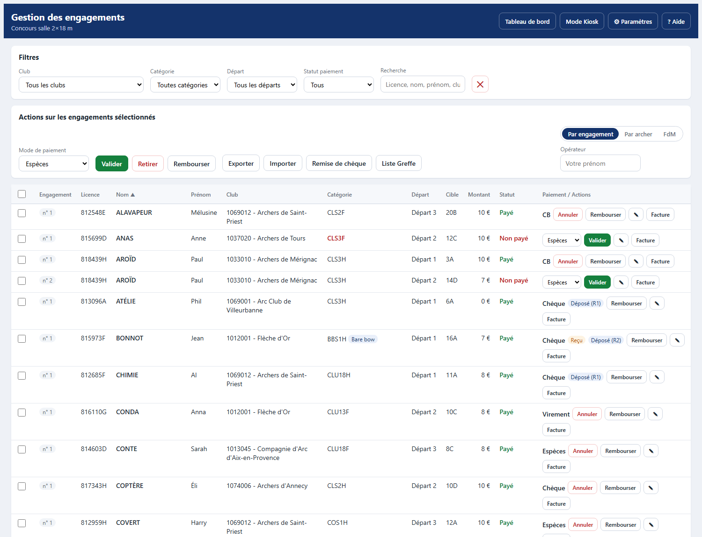

<table>
  <tr>
    <td align="center" valign="top" width="36%">
      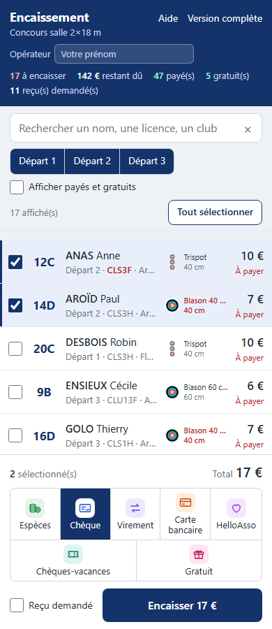 
      <strong>Encaisser sur téléphone</strong>
    </td>
    <td align="center" valign="top" width="64%">
      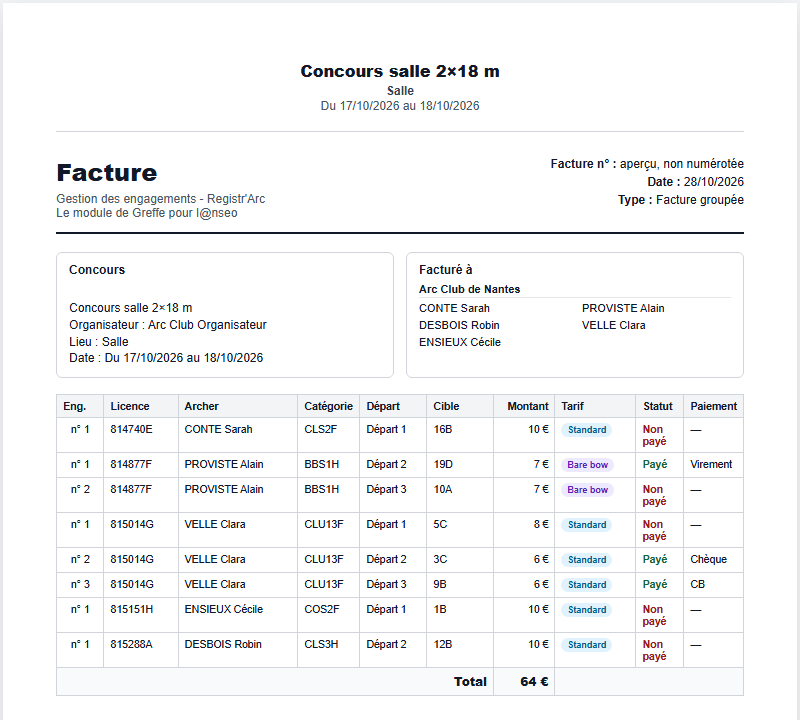 
      <strong>Imprimer une facture</strong>
        
      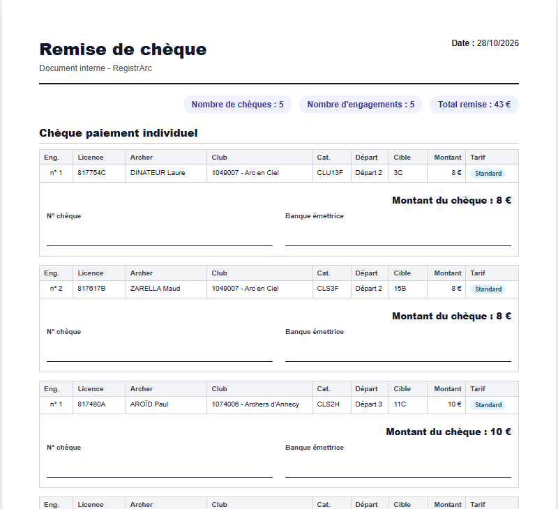 
      <strong>Déposer les chèques</strong>
    </td>
  </tr>
</table>

<table>
  <tr>
    <td align="center" valign="top" width="50%">
      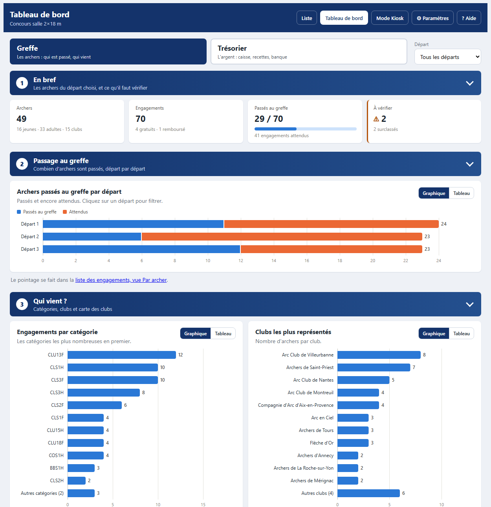 
      <strong>Suivre le concours</strong>
    </td>
    <td align="center" valign="top" width="50%">
      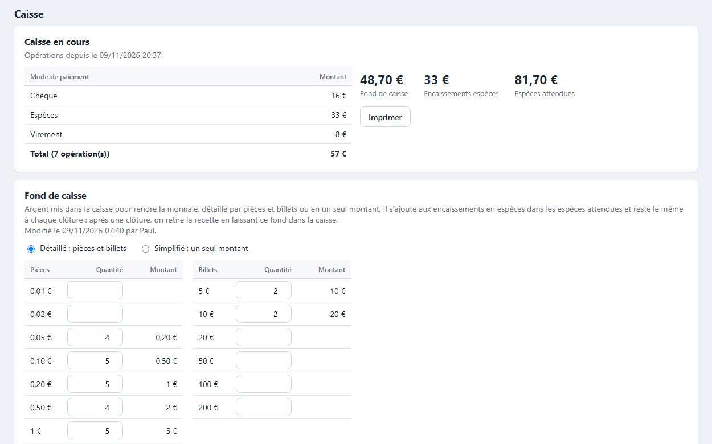 
      <strong>Clôturer la caisse</strong>
    </td>
  </tr>
</table>

## Ce que fait RegistrArc

<table>
  <tr>
    <td width="50%" valign="top">
      <strong>La liste des inscrits</strong> 
      Tous les archers du concours, avec ce que chacun doit payer pour chacun de ses départs, leur passage au greffe pointé départ par départ, et l'impression de leurs feuilles de marque.
    </td>
    <td width="50%" valign="top">
      <strong>L'encaissement</strong> 
      À l'ordinateur ou sur téléphone, en espèces, chèque, virement… et le remboursement d'un archer qui se désiste.
    </td>
  </tr>
  <tr>
    <td valign="top">
      <strong>Le mode Kiosk</strong> 
      Un écran pour encaisser debout sur téléphone, avec le blason de chaque archer et les cas à vérifier signalés en rouge.
    </td>
    <td valign="top">
      <strong>La caisse</strong> 
      Chaque opération est notée (qui, quand, sur quel appareil). Fond de caisse et clôture de caisse, détaillés pièce par pièce ou d'un seul montant.
    </td>
  </tr>
  <tr>
    <td valign="top">
      <strong>Les chèques</strong> 
      Un seul chèque pour plusieurs archers, bordereau de remise, suivi des remises déjà déposées.
    </td>
    <td valign="top">
      <strong>Les tarifs du club</strong> 
      Jeunes ou adultes, club organisateur ou non, tarif dégressif par départ, tarifs spéciaux, plafond.
    </td>
  </tr>
  <tr>
    <td valign="top">
      <strong>Les factures</strong> 
      Numérotées (2026-0001, 2026-0002…), prêtes à imprimer ou à envoyer en PDF, réimprimables à l'identique.
    </td>
    <td valign="top">
      <strong>Le tableau de bord</strong> 
      Deux vues claires, Greffe et Trésorier, en parties numérotées : chiffres clés, passage au greffe, caisse, recettes, banque, sauvegarde.
    </td>
  </tr>
  <tr>
    <td valign="top">
      <strong>Les paiements en ligne</strong> 
      Import des paiements HelloAsso, et QR codes pour retrouver un archer au kiosque.
    </td>
    <td valign="top">
      <strong>L'aide intégrée</strong> 
      Ce mode d'emploi, consultable dans le module même sans internet : bouton <strong>? Aide</strong>.
    </td>
  </tr>
</table>

RegistrArc ne modifie jamais les inscriptions dans I@nseo : il les lit et garde ses propres informations à part.

## Le greffe en 4 étapes

| | Quand | Quoi faire |
|:-:|---|---|
| **1** | Une fois pour toutes | [Installer le module](#installer-le-module) |
| **2** | Avant le concours | [Régler les tarifs et les modes de paiement](#régler-les-tarifs-et-les-paiements) |
| **3** | Pendant le concours | [Pointer les archers au greffe](#le-passage-au-greffe), encaisser [à l'ordinateur](#encaisser-à-lordinateur) ou [sur un téléphone](#encaisser-sur-un-téléphone) |
| **4** | Après le concours | [Clôturer la caisse](#la-caisse), [faire les factures](#faire-une-facture), [déposer les chèques](#préparer-la-remise-de-chèques), puis [clôturer le concours](#le-tableau-de-bord) |

> [!TIP]
> Dans la suite, cliquez sur un titre pour ouvrir la partie correspondante.

---

## Installer le module

<strong>Installer RegistrArc et donner les bons accès</strong>

 

1. Copiez le dossier **RegistrArc** dans le dossier **Modules/Custom** de votre I@nseo.
2. Ouvrez un concours dans I@nseo : RegistrArc apparaît dans le menu **Participants → Greffe**.
3. Si un message indique que le module ne peut pas enregistrer ses informations, voir les [questions fréquentes](#questions-fréquentes).

**Qui peut faire quoi ?**

| Action | Qui peut la faire |
|---|---|
| Voir le menu Greffe et consulter les pages | les personnes qui ont accès aux participants dans I@nseo |
| Encaisser, modifier les tarifs | les personnes qui peuvent modifier les participants |
| Installer une mise à jour du module | l'administrateur d'I@nseo |

Une personne qui a seulement le droit de consulter voit toutes les pages, mais les boutons pour encaisser ou modifier n'apparaissent pas.

## Régler les tarifs et les paiements

À faire avant chaque concours : dans la liste des engagements, cliquez sur **⚙ Paramètres**. Les réglages sont propres à chaque concours ; son numéro est rappelé sous le titre de la page.

La page suit quatre étapes, chacune sous un bandeau numéroté :

1. **Catégories** : quelles catégories paient le tarif jeunes, lesquelles le tarif adultes ;
2. **Tarifs d'inscription** : le tarif simple (par départ, et le plafond par archer), puis les tarifs personnalisés ;
3. **Paiements** : les moyens de paiement acceptés, et l'option qui pointe l'archer au greffe quand son paiement est validé ;
4. **Export / Import** des paramètres.

Un clic sur un bandeau replie ou déplie sa partie (chevron à droite) ; la page s'en souvient sur ce poste.

> [!IMPORTANT]
> Pensez à cliquer sur **Enregistrer les paramètres** : le bouton est en fin de page et reste toujours visible en bas de l'écran.

<strong>Jeunes et adultes</strong>

 

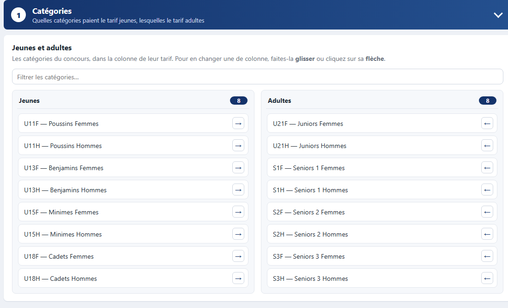

Les catégories du concours sont rangées en deux colonnes : **Jeunes** à gauche, **Adultes** à droite. Pour en changer une de colonne, faites-la glisser ou cliquez sur sa flèche.

Au départ, toutes les catégories en dessous de U21 (U11, U13, U15, U18) sont rangées dans les Jeunes ; U21 et les seniors dans les Adultes.

<strong>Prix des inscriptions</strong>

 

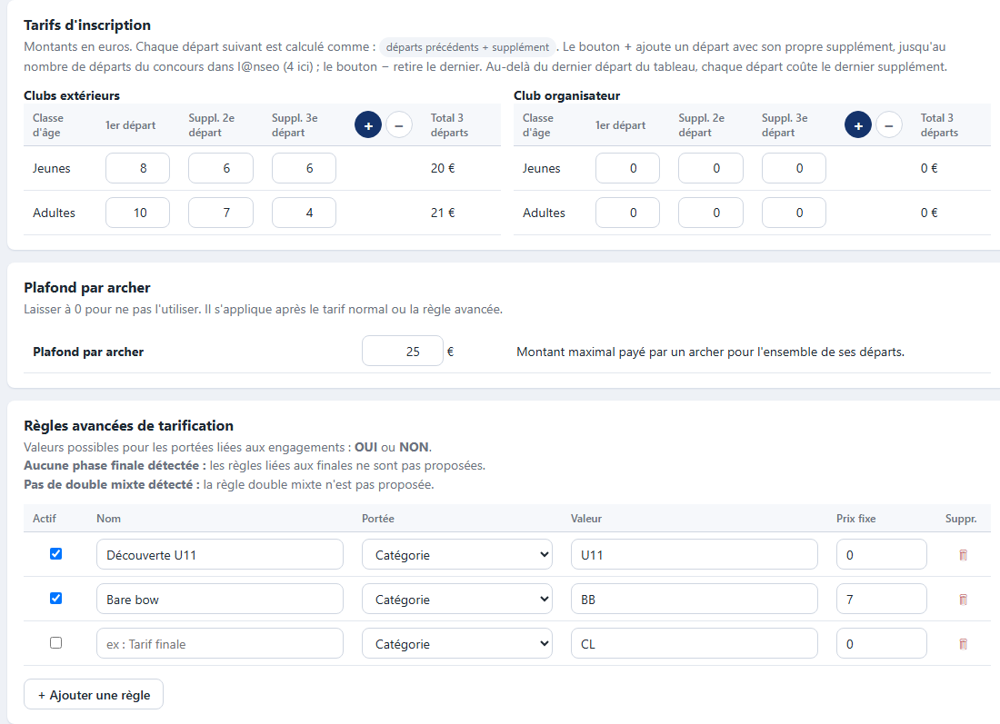

Pour les archers du club organisateur et pour ceux des autres clubs, jeunes et adultes, vous indiquez :

- le prix du **1er départ** ;
- le **supplément** à payer pour le **2e départ**, et si besoin pour le 3e, le 4e… (tarif dégressif).

Le bouton bleu **+** ajoute une colonne pour le départ suivant, avec son propre supplément. On peut en ajouter jusqu'au nombre de départs du concours dans I@nseo (rappelé au-dessus du tableau) ; une fois ce nombre atteint, le **+** devient gris. Le bouton **−** retire la dernière colonne. Au-delà du dernier départ du tableau, chaque départ coûte le dernier supplément. La colonne **Total** se met à jour pendant la saisie.

Exemple avec les prix proposés au départ (un seul supplément, répété à chaque départ). Le club organisateur est **gratuit** par défaut, jeunes et adultes :

| Archer | 1 départ | 2 départs | 3 départs |
|---|:-:|:-:|:-:|
| Jeune d'un autre club (8 € puis 6 €) | 8 € | 14 € | 20 € |
| Adulte d'un autre club (10 € puis 8 €) | 10 € | 18 € | 26 € |
| Archer du club organisateur (0 €) | 0 € | 0 € | 0 € |

Exemple de tarif dégressif sur 3 départs (un clic sur **+** pour ajouter le 3e), pour un adulte d'un autre club : 10 € le 1er départ, + 7 € le 2e, + 4 € le 3e.

| 1 départ | 2 départs | 3 départs | 4 départs |
|:-:|:-:|:-:|:-:|
| 10 € | 17 € | 21 € | 25 € |

Le club organisateur est celui indiqué dans les informations du concours, dans I@nseo. Les départs d'un même archer sont reconnus grâce à son numéro de licence.

<strong>Cas particuliers : tarif découverte, finales, gratuité…</strong>

 

Les **règles** donnent un prix spécial à certains archers. Pour chaque règle, vous indiquez :

- un **nom**, qui s'affiche dans la liste et sur la facture (par exemple « Tarif découverte U11 ») ;
- **ce que la règle regarde** et la **valeur** à reconnaître ;
- le **prix** à appliquer ;
- si elle est **active** (décochez pour la mettre de côté sans la supprimer).

| La règle regarde… | Elle s'applique quand… | Exemple |
|---|---|:-:|
| Catégorie | la catégorie de l'archer contient la valeur | `U11` |
| Région | le numéro du club commence par ces 2 chiffres | `10` |
| Département | le numéro du club contient ces chiffres en 3e et 4e position | `69` |
| Qualification individuelle ou par équipe | l'archer y participe (`OUI`) ou non (`NON`) | `OUI` |
| Finale individuelle, par équipe, double mixte | pareil ; proposé seulement si une épreuve du concours a des phases finales. En individuel, l'archer compte comme finaliste si sa catégorie est dans une épreuve avec phases finales | `OUI` |

À savoir :

- le prix d'une règle **remplace** le prix normal ;
- si plusieurs règles concernent le même archer, leurs prix **s'ajoutent** ;
- une règle à **0 €** rend l'inscription gratuite.

<strong>Plafond par archer</strong>

 

**Plafond par archer** (laisser à 0 pour ne pas s'en servir) : un archer ne paie jamais plus que ce montant pour l'ensemble de ses départs.

<strong>Modes de paiement et inscriptions gratuites</strong>

 

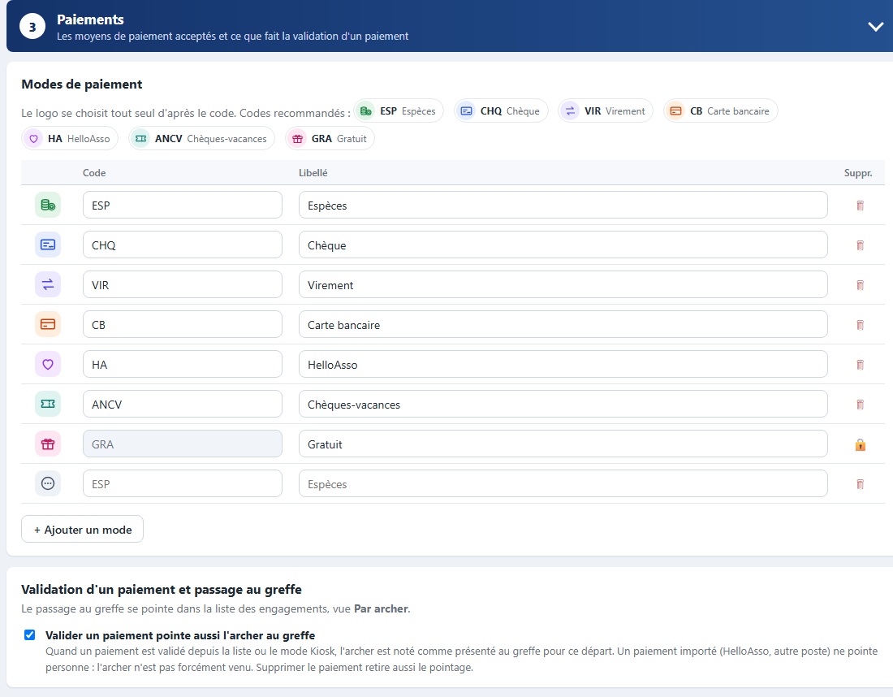

Espèces, Chèque, Virement et Gratuit sont proposés au départ. Vous pouvez en ajouter (par exemple Carte bancaire) ou les renommer. Seuls les paiements par **chèque** apparaissent sur la remise de chèques.

Chaque mode a son **logo**, choisi d'après le code : billet pour `ESP`, chèque pour `CHQ`, flèches pour `VIR`, carte pour `CB`, cœur pour un paiement en ligne (`HA` pour HelloAsso), ticket pour les chèques-vacances (`ANCV`), cadeau pour `GRA`. Un autre code reçoit un logo neutre.

**Inscriptions gratuites** : quand le prix d'une inscription est de 0 €, l'archer n'a rien à payer. RegistrArc l'affiche « Gratuit » et ne le compte pas parmi les archers à encaisser : il n'y a rien à valider.

<strong>Reprendre les réglages d'un autre concours</strong>

 

À la fin de la page des réglages (étape 4) :

- **Exporter** enregistre tous vos réglages dans un fichier ;
- **Importer** les recharge, par exemple pour reprendre les tarifs de l'an dernier ou les mettre sur un autre ordinateur.

Avant de remplacer vos réglages, RegistrArc vous prévient si le fichier vient d'un autre concours ou s'il est plus ancien que vos réglages actuels.

Pour retrouver à la main les fichiers d'un concours (dans le dossier `data/` du module), cherchez son numéro : l'étape 4 rappelle le nom des fichiers, par exemple `settings_12.json` pour les réglages du concours n° 12.

## Pendant le concours

### Encaisser à l'ordinateur

<strong>La liste des engagements</strong>

 

C'est l'écran principal (voir l'aperçu en haut de cette page). Chaque ligne est un départ d'un archer : licence, nom, club, catégorie, départ, cible, montant et état du paiement.

- **Chercher un archer** : par club, catégorie, départ, état du paiement (payés, non payés, gratuits, remboursés) ou en tapant un nom, une licence, un club. La liste se met à jour au fil de la frappe, sans bouton à cliquer. Pour afficher **plusieurs archers à la fois**, séparez les recherches par un point-virgule : `terrieur ; 812137B ; dupont` affiche ces trois archers. Il suffit ensuite de les cocher pour les encaisser ou les facturer ensemble. La **croix rouge** ✕ remet tous les filtres à zéro.
- **Trier** : cliquez sur le titre d'une colonne ; cliquez à nouveau pour inverser l'ordre.
- **Trois vues** : l'interrupteur à droite du titre « Actions sur les engagements sélectionnés » change la présentation de la liste. La vue **Par engagement** (une ligne par départ, avec le paiement) sert à encaisser ; la vue **Par archer** sert à suivre le [passage au greffe](#le-passage-au-greffe) ; la vue **FdM** sert à [imprimer les feuilles de marque](#imprimer-les-feuilles-de-marque).
- **Repères** : « Archer non affecté » signale un archer sans cible ; une étiquette violette indique un prix spécial ; une catégorie en rouge signale un archer **surclassé** (au survol : « Surclassé : U15F > U18F »).

### Le passage au greffe

<strong>Pointer les archers qui se présentent</strong>

 

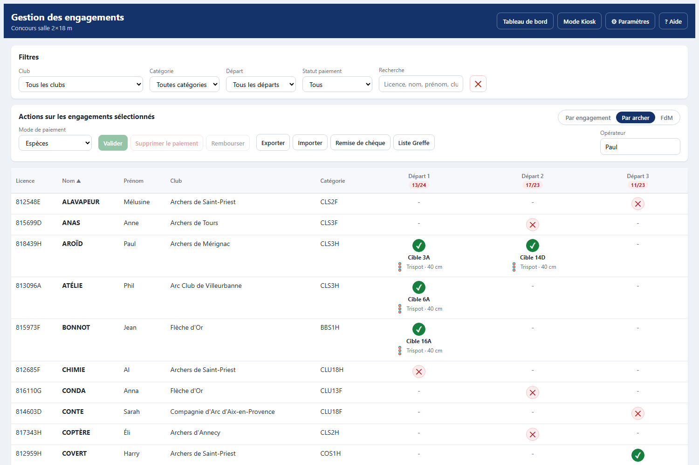

Choisissez **Par archer** avec l'interrupteur à droite du titre « Actions sur les engagements sélectionnés ». La liste montre une ligne par archer (licence, nom, prénom, club, catégorie) et une colonne par départ :

- **-** : l'archer ne tire pas ce départ ;
- **✕ rouge** : il n'est pas encore passé au greffe. Un clic sur la croix le pointe ;
- **✓ vert** : il est passé au greffe. Son numéro de cible et son blason s'affichent dessous (blason en rouge s'il n'est pas celui de sa catégorie). Un clic sur la coche annule le pointage.

Sous le titre de chaque départ, une pastille indique les **archers encore à passer au greffe** sur ceux attendus (par exemple **8/23**, en rouge), puis **✓ 23** en vert quand tout le monde est passé. Ces chiffres tiennent compte des filtres : avec le filtre **Départ**, on suit un seul départ. La recherche marche aussi (avec « ; » pour plusieurs archers).

Pour encaisser, revenez à la vue **Par engagement**.

> [!TIP]
> **Pointer en encaissant** : dans **⚙ Paramètres**, partie **Paiements**, l'option « Valider un paiement pointe aussi l'archer au greffe » est cochée par défaut. Chaque paiement validé depuis la liste ou le mode Kiosk pointe alors l'archer pour ce départ, sans clic de plus. Un paiement importé (HelloAsso, autre poste) ne pointe personne, et **Supprimer le paiement** retire aussi le pointage. Décochez l'option pour pointer à part.

### Imprimer les feuilles de marque

<strong>Feuille de marque d'un ou plusieurs archers, avec ses scores</strong>

 

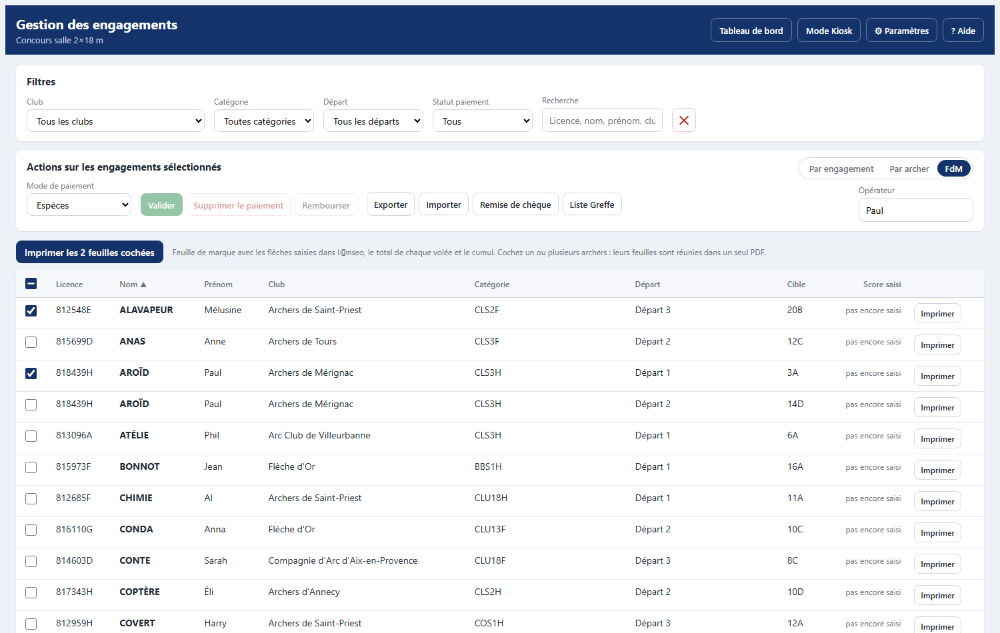

Choisissez **FdM** avec l'interrupteur à droite du titre « Actions sur les engagements sélectionnés ». La liste montre une ligne par départ de chaque archer, avec sa cible et le **score déjà saisi** dans I@nseo (et le nombre de flèches).

- **Imprimer**, au bout d'une ligne, ouvre la feuille de marque de cet archer.
- Pour en imprimer **plusieurs**, cochez-les (ou cochez la case du titre pour tout prendre), puis **Imprimer les feuilles cochées** : toutes les feuilles arrivent dans **un seul PDF**, prêt à imprimer.
- Les filtres et la recherche marchent comme dans la liste : par club, par départ, ou plusieurs archers séparés par « ; ».

La feuille est celle d'I@nseo, avec les réglages de sa page d'impression : **feuille complète avec la colonne des totaux progressifs**, toutes les distances sur une seule page, le **drapeau ou logo du club**, l'en-tête et le pied de page sur toute la page. On y trouve **chaque flèche saisie**, le total de chaque volée, le **cumul**, les 10 et les X, et les cases de signature. Un archer sans score saisi a une feuille vierge à son nom. Il faut avoir, dans I@nseo, le droit de consulter les qualifications. Pour un concours en parcours ou en 3D, imprimez les feuilles une par une (bouton **Imprimer** de chaque ligne).

<strong>Encaisser un ou plusieurs archers</strong>

 

- **Un archer** : sur sa ligne, choisissez le mode de paiement, puis **Valider**. En cas d'erreur, **Annuler** le remet en « Non payé ».
- **Plusieurs archers** : cochez leurs lignes, choisissez le mode de paiement en haut de la liste, puis **Valider**. **Supprimer le paiement** remet les engagements cochés en « Non payé », et **Rembourser** enregistre leur remboursement. Ces trois boutons s'activent dès que 2 engagements sont cochés ; pour un seul archer, utilisez les boutons de sa ligne.
- **Un chèque pour plusieurs archers** : si vous validez au moins 2 archers par chèque, RegistrArc propose d'en faire un **chèque groupé**. Ils apparaîtront ensemble sur la remise de chèques.

> [!TIP]
> Tapez votre prénom dans le champ **Opérateur** : il est retenu sur l'ordinateur et noté avec chaque encaissement dans la [caisse](#la-caisse).

<strong>Rembourser, supprimer un paiement, noter</strong>

 

- **Rembourser** : sur la ligne d'un archer payé, **Rembourser**, choisissez comment il est remboursé (espèces, chèque, virement) et indiquez le **motif**, obligatoire (blessure, désistement…). Il passe en « Remboursé », le motif s'affiche sous la mention « Remboursé » et le remboursement apparaît dans la caisse avec son motif. Pour plusieurs archers cochés, le motif est demandé au moment de cliquer sur **Rembourser**.
- **Annuler** (archer payé) ou **Supprimer le paiement** (archer remboursé) sert à corriger une erreur : l'archer redevient « Non payé » et n'est plus pointé au greffe pour ce départ. Sur un archer remboursé, le remboursement est annulé en même temps ; la caisse garde les deux opérations, chacune dans son mode de paiement. Un chèque déjà déposé à la banque ne peut plus être annulé, seulement remboursé.
- **Le bouton ✎** ajoute une note visible par tout le greffe (« paiera dimanche », « chèque à l'ordre du club »…).

<strong>Les autres boutons de la liste</strong>

 

- **Le compteur** devant les boutons (par exemple **1 234 cochés**) rappelle combien d'engagements sont cochés.
- **Facture** et **Facture groupée** : voir [Faire une facture](#faire-une-facture).
- **Remise de chèque** : voir [Préparer la remise de chèques](#préparer-la-remise-de-chèques).
- **Liste Greffe** : imprime la liste telle qu'elle est affichée à l'écran.
- **Exporter / Importer** : recopie les paiements d'un ordinateur RegistrArc à un autre, par exemple de l'ordinateur des pré-inscriptions vers celui du greffe. Seuls les paiements sont recopiés : les inscriptions dans I@nseo ne changent pas.

### Encaisser sur un téléphone

<strong>Le mode Kiosk</strong>

 

Le bouton **Mode Kiosk** ouvre un écran fait pour encaisser debout, avec un téléphone ou une tablette connecté au même réseau que l'ordinateur I@nseo.

<table>
  <tr>
    <td align="center">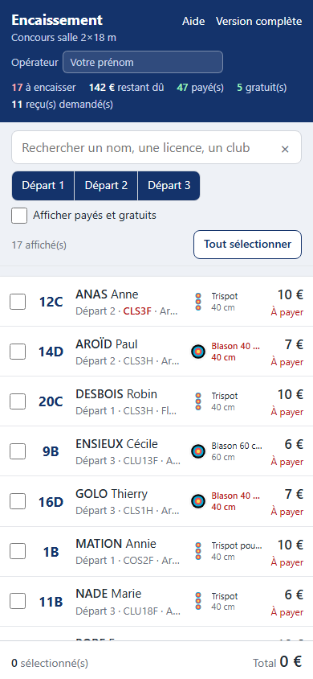</td>
    <td align="center"></td>
  </tr>
  <tr>
    <td align="center">L'écran</td>
    <td align="center">Pendant l'encaissement</td>
  </tr>
</table>

1. **Trouvez l'archer** en tapant son nom, sa licence, son club ou son blason, ou en choisissant le départ. Seuls les archers qui doivent encore payer sont affichés ; cochez **Afficher payés et gratuits** pour voir tout le monde.
2. **Touchez sa ligne**, ou plusieurs lignes. **Tout sélectionner** coche toutes les lignes affichées. Le total apparaît en bas.
3. **Choisissez le mode de paiement** (chaque mode a son logo : pièces, chèque, carte…), cochez **Reçu demandé** si l'archer veut un reçu, puis **Encaisser**.

En haut de l'écran : le nombre d'archers à encaisser, la somme qui reste à encaisser, le nombre de payés et le nombre de reçus demandés. Tapez votre prénom dans le champ **Opérateur** : il est retenu sur le téléphone.

Le « reçu demandé » se coche uniquement dans le mode Kiosk ; la liste des engagements l'affiche ensuite. Le lien **Aide** ouvre ce mode d'emploi, **Version complète** revient à la liste des engagements.

<strong>Les repères de chaque ligne : blason, surclassement</strong>

 

Chaque ligne montre, de gauche à droite : la cible, le nom de l'archer avec son départ, sa catégorie et son club, puis **son blason**, et enfin le montant.

Le **blason** est celui réglé dans I@nseo : son image, son nom et son diamètre (par exemple « Trispot · 40 cm »). Si l'archer change de blason selon la distance, les deux s'affichent.

Deux cas sont signalés **en rouge**, pour vérifier avant le début des tirs :

| En rouge | Ce que cela veut dire |
|---|---|
| **Le blason** | L'archer n'a pas le blason prévu par défaut pour sa catégorie dans I@nseo. |
| **La catégorie** | L'archer est **surclassé** : sa catégorie d'âge (d'après sa date de naissance) n'est pas sa catégorie de classement. |

Gardez le doigt appuyé (ou passez la souris) sur l'élément en rouge pour voir le détail, par exemple « blason par défaut de la catégorie : Piquet Blanc » ou « Surclassé : U15F > U18F ». Taper **surclassé** dans la recherche liste tous les archers surclassés.

Ces repères sont seulement des informations : ils ne changent ni le prix ni l'inscription. Pour corriger un blason ou une catégorie, passez par I@nseo.

<strong>Retrouver un archer avec un QR code</strong>

 

Depuis le tableau de bord, **Imprimer les QR codes** prépare une planche d'étiquettes, une par archer, à coller sur la feuille de marque ou la fiche d'inscription. Scanné avec l'appareil photo d'un téléphone connecté au même réseau, le QR code ouvre le mode Kiosk directement sur cet archer.

Si l'ordinateur du greffe ouvre I@nseo par une adresse « localhost », indiquez en haut de la page l'adresse du serveur sur le réseau (par exemple `http://192.168.1.10/…`), sinon les téléphones ne pourront pas l'ouvrir.

### Paiements faits en ligne

<strong>Importer les paiements HelloAsso</strong>

 

Depuis le tableau de bord, **Importer des paiements HelloAsso** :

1. Envoyez le fichier exporté depuis HelloAsso (liste des participants ou des commandes, format tableur).
2. Vérifiez quelle colonne contient la licence, le nom, le prénom, le montant et le statut : RegistrArc les devine d'après leurs titres.
3. Contrôlez les correspondances : chaque archer est retrouvé par sa licence, sinon par son nom et prénom. Les lignes cochées sont marquées payées ; un montant inférieur au montant dû est signalé et décoché.

Les paiements importés apparaissent dans la caisse avec l'origine « HelloAsso ».

## Après le concours

### La caisse

<strong>Les opérations et la clôture de caisse</strong>

 

La caisse se trouve dans le **Tableau de bord**, vue **Trésorier**, partie **2. Caisse**. Elle montre tout ce qui a été encaissé, annulé ou remboursé depuis la dernière clôture : total par mode de paiement et liste des opérations, avec l'heure, l'opérateur et l'appareil utilisé. **Imprimer** ouvre la caisse en cours sur une page à imprimer.

Le **fond de caisse** est la monnaie mise dans la caisse avant d'ouvrir. Deux façons de le saisir, au choix :

- **Détaillé** : le nombre de pièces et de billets de chaque valeur (de 0,01 € à 200 €). Le total se calcule tout seul.
- **Simplifié** : un seul montant, sans détail.

Cliquez ensuite sur **Enregistrer le fond de caisse**. Les espèces attendues comprennent ce fond en plus des encaissements en espèces. Le fond reste le même d'une clôture à l'autre : après chaque clôture, on retire la recette et on laisse le fond dans la caisse.

Pour **clôturer la caisse** (en fin de matinée, de journée…) :

1. Comptez les pièces et les billets présents dans la caisse, fond compris.
2. Choisissez le comptage, quel que soit le type du fond de caisse :
   - **Détaillée** : tapez la quantité de chaque valeur, le total compté s'affiche au fur et à mesure ;
   - **Simplifiée** : tapez seulement le montant compté.

   Par défaut, la clôture suit le type du fond de caisse.
3. Cliquez sur **Clôturer la caisse**.

RegistrArc affiche alors l'écart avec les espèces attendues, et la somme **à retirer en laissant le fond**. Chaque clôture reste consultable dans **Clôtures précédentes** : **Voir / imprimer** ouvre son rapport, avec le détail du comptage et du fond. Les opérations qui suivent comptent pour la clôture suivante.

### Le tableau de bord

<strong>Les deux vues : Greffe et Trésorier</strong>

 

En haut, choisissez la **vue** qui correspond à votre rôle, **Greffe** ou **Trésorier**, et éventuellement un **départ** : tous les chiffres et graphiques suivent. RegistrArc retient la dernière vue ouverte sur l'appareil.

Chaque vue est découpée en parties numérotées, comme les paramètres. Un clic sur un bandeau replie ou déplie sa partie ; la page s'en souvient sur ce poste.

| Vue | Ses parties |
|---|---|
| **Greffe** | 1. **En bref** : archers (jeunes, adultes, clubs), engagements, **passés au greffe** (avec jauge), **à vérifier** (sans cible, surclassés) · 2. **Passage au greffe** : passés et attendus, départ par départ · 3. **Qui vient ?** : catégories, clubs les plus représentés, **carte des clubs** · 4. **Outils du greffe** : QR codes, villes des clubs, liste pour le tableur |
| **Trésorier** | 1. **En bref** : encaissé (avec jauge), reste dû, **chèques à déposer**, **écart de caisse** · 2. **[Caisse](#la-caisse)** : fond de caisse, clôture, opérations · 3. **Recettes** : par mode de paiement, par départ, au fil du temps, **reste dû par club** (pour les relances) · 4. **Banque et factures** : remises de chèques, clôtures, factures émises, fichiers pour le tableur, import HelloAsso · 5. **Sauvegarde et fin du concours** |

Le pointage des archers se fait dans la vue **par archer** de la liste : voir [le passage au greffe](#le-passage-au-greffe).

- Les tuiles marquées **⚠** signalent un point à vérifier (archers sans cible ou surclassés, reste dû, chèques pas encore déposés, écart de caisse).
- Passez la souris (ou le doigt) sur une barre ou la courbe pour voir le détail. Cliquer sur un départ dans un graphique le sélectionne pour toute la page.
- Chaque graphique a un bouton **Tableau** qui montre les mêmes chiffres sous forme de tableau.

  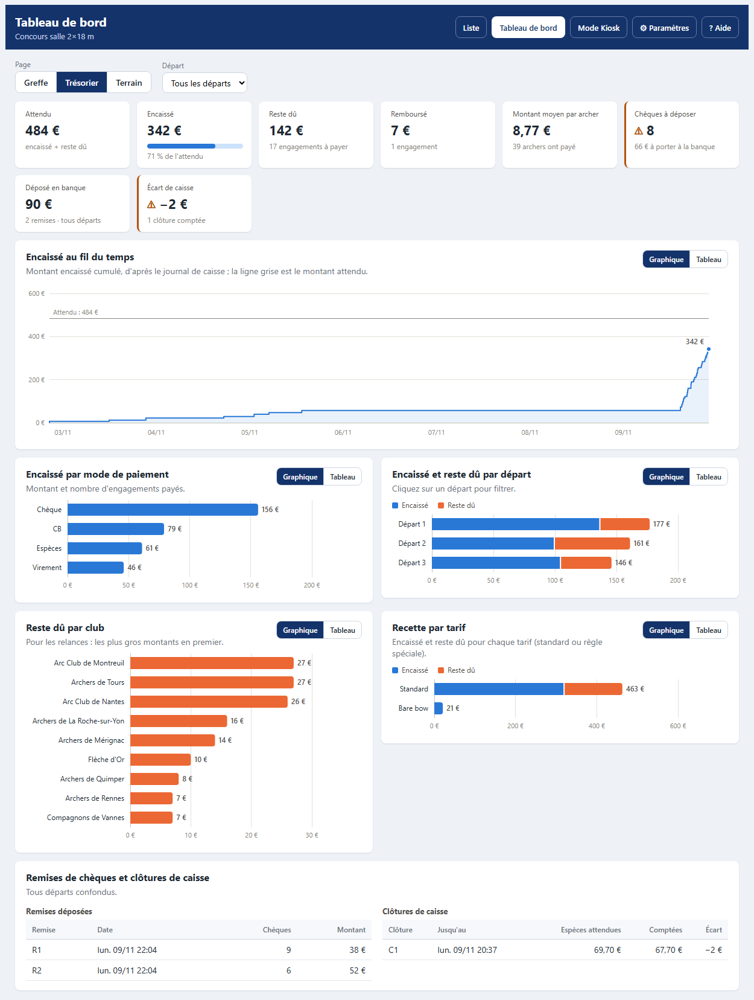 
  <strong>Vue Trésorier</strong>

- **La carte des clubs** place une bulle par club, sur sa ville. I@nseo ne connaissant pas la ville des clubs, RegistrArc la cherche dans le nom du club, parmi les communes de son département (3e et 4e chiffres du numéro de club FFTA). La taille de la bulle suit le nombre d'archers ; le survol donne le club, ses archers, ses engagements, son reste dû et sa ville. Une bulle **pâle en pointillé** signale un club dont la ville n'a pas été trouvée : il est placé au centre de son département.
- **Villes des clubs** (lien sous la carte, ou bouton dans « Outils ») : la liste des clubs du concours avec la ville trouvée ; tapez une autre commune pour corriger ou compléter (des suggestions s'affichent). La correction est retenue pour tous les concours suivants ; laissez le champ vide pour revenir à la ville trouvée automatiquement. Le fond de carte vient d'OpenStreetMap et demande une connexion internet : sans internet, les bulles restent placées sur un fond vide. Les clubs dont le numéro ne correspond à aucun département (club étranger par exemple) sont listés sous la carte.

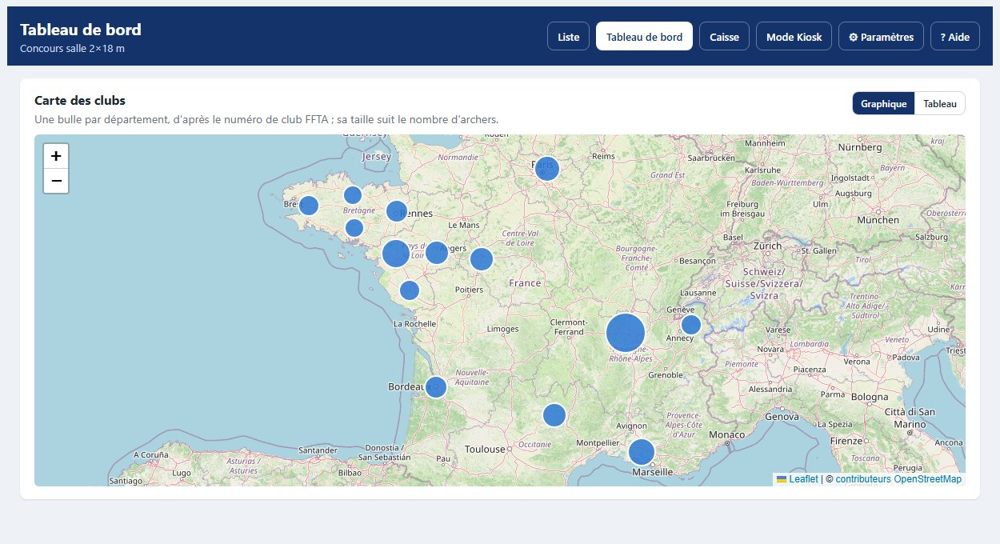

<strong>Factures, fichiers pour le trésorier, sauvegarde, fin du concours</strong>

 

- **Les factures émises** du concours, à réimprimer.
- **Pour le trésorier** : la liste des engagements et le journal des opérations en fichiers à ouvrir dans Excel ou LibreOffice, la remise de chèques et la caisse.
- **Sauvegarde** : un seul fichier avec toutes les informations du concours, à garder en lieu sûr ; **Restaurer** le recharge si besoin.
- **Fin du concours** : une fois les comptes faits, **Clôturer le concours** empêche toute nouvelle modification. Il peut être rouvert au même endroit.

### Faire une facture

<strong>Facture d'un archer ou de plusieurs</strong>

 

- **Pour un archer** : bouton **Facture** sur sa ligne.
- **Pour plusieurs archers** (par exemple tout un club) : cochez leurs lignes, puis **Facture groupée**.

La facture s'ouvre dans un nouvel onglet. Elle indique le concours, les archers regroupés par club, le détail de chaque départ et le total. **Imprimer / Enregistrer en PDF** permet de l'imprimer, ou de l'enregistrer en PDF pour l'envoyer ensuite par e-mail.

La facture s'ouvre d'abord en **aperçu**, sans numéro. **Émettre la facture** lui donne un numéro définitif qui se suit sur l'année (2026-0001, 2026-0002…) et l'enregistre telle quelle : elle se réimprime à l'identique depuis le tableau de bord. Si une facture a déjà été émise pour les mêmes archers, RegistrArc l'indique avec un lien vers elle.

### Préparer la remise de chèques

<strong>Le bordereau pour la banque</strong>

 

Le bouton **Remise de chèque** prépare la feuille à déposer avec les chèques :

- **sans rien cocher**, elle reprend tous les chèques du concours ;
- **en cochant des lignes**, elle ne reprend que les chèques de ces archers.

Elle indique le nombre de chèques, le nombre d'inscriptions et le total. Pour chaque chèque, il reste à écrire à la main le numéro du chèque et la banque. En bas : « Préparé par » et « Déposé le ».

Une fois les chèques déposés à la banque, **Enregistrer comme déposée** : la remise reçoit un numéro (R1, R2…), ses chèques ne reviennent plus sur les bordereaux suivants et sont marqués « Déposé » dans la liste. Les remises enregistrées restent consultables et réimprimables en bas de la page ; une remise enregistrée par erreur peut être annulée.

Les chèques groupés se tiennent à jour tout seuls : si vous annulez le paiement d'un archer, il quitte son chèque groupé.

---

## L'aide dans le module

Ce mode d'emploi est disponible dans RegistrArc, même sans internet : bouton **? Aide** en haut des pages (lien **Aide** dans le mode Kiosk).

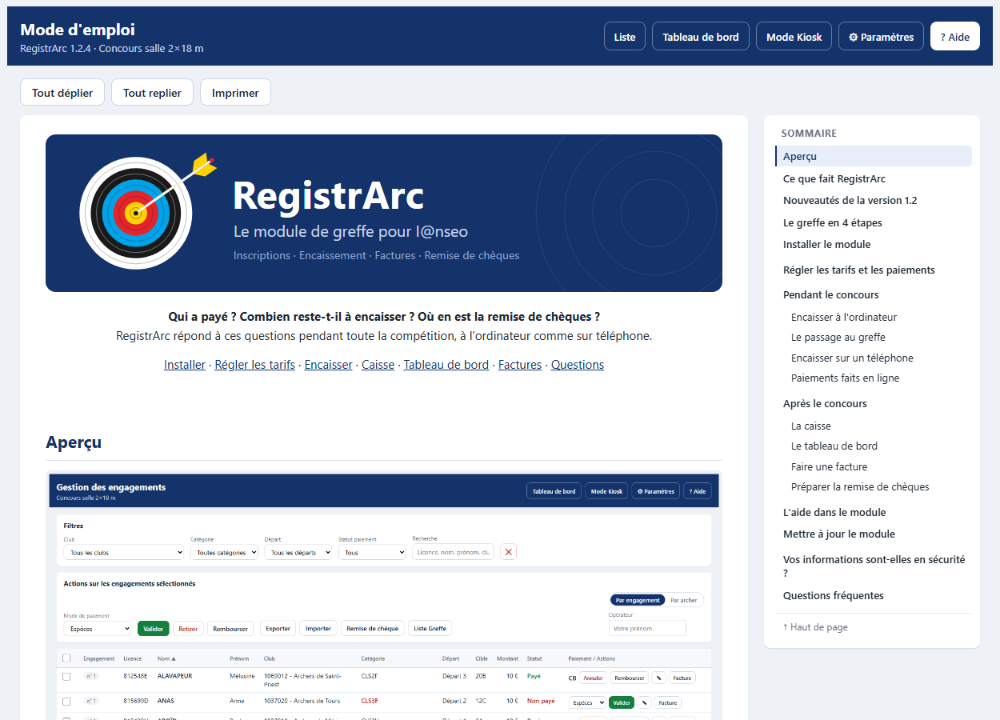

- Le **sommaire**, à droite, suit votre lecture ; cliquez sur une partie pour y aller directement. Sur téléphone, il s'ouvre avec le bouton **Sommaire**.
- **Tout déplier**, **Tout replier** et **Imprimer** sont en haut de la page.
- Depuis les paramètres ou le mode Kiosk, l'aide s'ouvre directement sur la partie qui les concerne.
- **Signaler un problème**, en haut à droite, ouvre le dépôt GitHub du module (voir ci-dessous).

### Signaler un problème ou proposer une idée

Un bug, un écran pas clair, une idée pour le greffe ? Déposez un ticket (une « issue ») sur le dépôt GitHub du module :

**[github.com/Musica405archery/RegistrArc/issues](https://github.com/Musica405archery/RegistrArc/issues)**

1. Créez un compte GitHub gratuit si vous n'en avez pas, puis cliquez sur **New issue**.
2. Donnez un titre court, par exemple « La caisse n'affiche pas le fond de caisse ».
3. Expliquez ce que vous avez fait, ce que vous attendiez et ce qui s'est passé. Indiquez la version de RegistrArc (en bas de la page **⚙ Paramètres**).
4. Une capture d'écran aide beaucoup.

> [!WARNING]
> Les tickets sont **publics**. N'y mettez pas de noms d'archers, de numéros de licence ni de données de paiement : masquez-les sur les captures d'écran.

## Vos informations sont-elles en sécurité ?

- **Chaque concours a ses propres paiements et réglages**, sans mélange.
- **Plusieurs personnes peuvent encaisser en même temps** (l'ordinateur du greffe et des téléphones) sans s'effacer mutuellement.
- **Chaque opération est notée** dans le journal de la caisse : rien ne s'efface.
- **Les fichiers pour le tableur sont protégés** : un nom ou une note qui ressemblerait à une formule n'est pas exécuté à l'ouverture dans Excel ou LibreOffice.
- **Pour faire une sauvegarde**, utilisez **Télécharger une sauvegarde** dans le tableau de bord.

> [!WARNING]
> **Attention aux onglets.** Dans un même navigateur, ouvrir un autre concours dans I@nseo change le concours de tous les onglets. Si vous encaissez depuis un onglet resté sur l'ancien concours, RegistrArc refuse et vous demande de recharger la page : rien n'est enregistré au mauvais endroit.

## Questions fréquentes

Un message dit que le module ne peut pas enregistrer ses informations

 

L'ordinateur n'autorise pas RegistrArc à écrire dans son dossier. Demandez à la personne qui gère l'ordinateur I@nseo d'autoriser l'écriture dans le dossier **RegistrArc** (et son dossier **data**). Le message indique l'emplacement exact.

Un archer n'a pas le bon prix

 

Dans les réglages, vérifiez :

1. que sa catégorie est dans la bonne colonne (Jeunes ou Adultes) ;
2. que son club est bien le club organisateur, s'il doit avoir ce tarif ;
3. qu'aucune règle active ne le concerne par erreur.

Un blason ou une catégorie est en rouge dans le mode Kiosk

 

Ce n'est pas une erreur de RegistrArc, mais un point à vérifier :

- **blason en rouge** : l'archer n'a pas le blason par défaut de sa catégorie dans I@nseo ;
- **catégorie en rouge** : l'archer est surclassé (sa catégorie d'âge n'est pas sa catégorie de classement).

Le détail s'affiche en gardant le doigt appuyé sur l'élément. Si c'est voulu, il n'y a rien à faire ; sinon, corrigez l'archer dans I@nseo. Voir [les repères de chaque ligne](#encaisser-sur-un-téléphone).

« Formulaire expiré ou invalide »

 

La page était ouverte depuis longtemps. Rechargez-la et recommencez : rien n'a été enregistré.

« Le tournoi ouvert a changé depuis l'affichage de cette page »

 

Un autre concours a été ouvert dans I@nseo entre-temps. Rechargez la page : elle affichera le concours actuellement ouvert.

Je me suis trompé de mode de paiement ou d'archer

 

**Annuler** sur la ligne remet l'archer en « Non payé » ; encaissez ensuite correctement. Les deux opérations restent visibles dans la caisse. Un chèque déjà déposé ne peut plus être annulé : utilisez **Rembourser**.

Je ne peux plus encaisser : « le concours est clôturé »

 

Le concours a été clôturé depuis le tableau de bord. Rouvrez-le au même endroit (vue Trésorier, partie « Sauvegarde et fin du concours ») si des modifications sont encore nécessaires.

## Mettre à jour le module

Quand une nouvelle version de RegistrArc existe, un bouton vert **⬆ Mise à jour** apparaît en haut de la liste. Seul l'administrateur d'I@nseo le voit.

<strong>Comment se passe la mise à jour</strong>

 

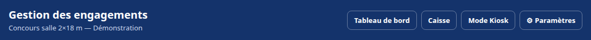

Le bouton ouvre une page qui montre la version installée, la nouvelle version et ses nouveautés. Cliquez sur **Installer la version…**.

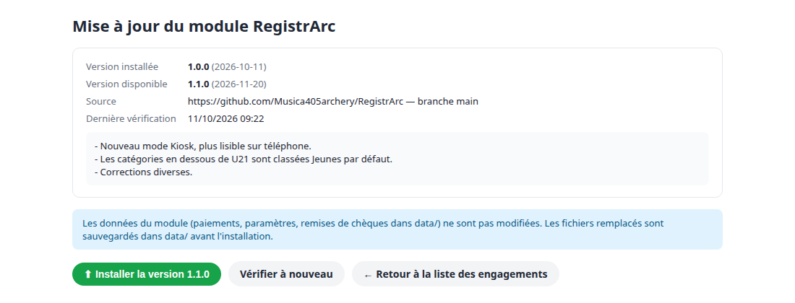

- Vos paiements et vos réglages ne sont pas touchés.
- Chaque fichier téléchargé est vérifié avant d'être installé ; si un seul ne correspond pas, ou si l'installation échoue en route, rien n'est changé.
- La mise à jour installe toujours la dernière version publiée, et tous ses fichiers ensemble.
- Le module vérifie s'il existe une nouvelle version toutes les 6 heures. Pour vérifier tout de suite, l'administrateur ouvre la page de mise à jour avec `update.php?force=1`.
- Sans internet, RegistrArc fonctionne normalement : le bouton n'apparaît simplement pas.

Quelle version de RegistrArc est installée ?

 

Elle est indiquée en petit, en bas à droite de la page **⚙ Paramètres** (par exemple « RegistrArc 1.2.6 »), et dans le sous-titre de la page d'aide.

Le bouton « Mise à jour » n'apparaît jamais

 

Il n'apparaît que pour l'administrateur d'I@nseo, quand l'ordinateur a accès à internet et qu'une nouvelle version existe.

## Notes de version

Ce qui change pour vous à chaque nouvelle version. La version installée est écrite en petit, en bas de la page **⚙ Paramètres**.

### Version 1.2.6

**Au greffe**

- **Encaisser pointe l'archer** : valider un paiement depuis la liste ou le mode Kiosk note aussi l'archer comme passé au greffe pour ce départ. C'est réglé par défaut ; l'option se décoche dans **⚙ Paramètres**, partie **Paiements**.
- **Supprimer le paiement défait tout** : l'engagement redevient à payer, le remboursement éventuel est annulé, et l'archer n'est plus pointé au greffe.
- **Un remboursement demande toujours un motif** (forfait, erreur d'inscription…), noté dans la caisse.
- **Les boutons groupés** (Valider, Supprimer le paiement, Rembourser) ne s'activent qu'à partir de 2 engagements cochés ; pour un seul, utilisez les boutons de sa ligne. Le nombre d'engagements cochés s'affiche une fois, devant les boutons.
- **Le choix de la vue** (Par engagement, Par archer, FdM) est à droite du titre « Actions sur les engagements sélectionnés », le champ **Opérateur** juste dessous.
- **Plus d'inscription tardive** : la case et la majoration disparaissent.

**Pour le trésorier**

- **Un tableau de bord plus clair**, en deux vues : **Greffe** (en bref, passage au greffe départ par départ, qui vient, outils) et **Trésorier** (en bref, caisse, recettes, banque et factures, sauvegarde et fin du concours). Chaque partie se replie d'un clic sur son bandeau. Voir [le tableau de bord](#le-tableau-de-bord).
- **Clôture de caisse simplifiée** : à chaque clôture, comptez pièce par pièce ou tapez un seul montant, quel que soit le type du fond de caisse.
- **Des logos pour les moyens de paiement** (pièces, chèque, carte, virement…), dans les paramètres et le mode Kiosk.

**Dans les paramètres**

- **Une page en quatre parties numérotées** : catégories, tarifs, paiements, export / import. Chaque partie se replie, et **Enregistrer les paramètres** reste toujours visible en bas de l'écran.
- **Le numéro du concours** est rappelé sous le titre, pour retrouver ses fichiers.
- **Finales** : un archer compte comme finaliste individuel seulement si sa catégorie est dans une épreuve qui a des phases finales.

<strong>Version 1.2.5</strong>

 

**Au greffe**

- **Imprimer les feuilles de marque** : choisissez **FdM** au-dessus du champ Opérateur. La liste montre chaque archer avec sa cible et le score déjà saisi. **Imprimer** sort la feuille d'un archer ; cochez-en plusieurs pour les avoir toutes dans un seul PDF. La feuille est celle d'I@nseo : chaque flèche, le total de chaque volée, le cumul, et le logo du club. Voir [imprimer les feuilles de marque](#imprimer-les-feuilles-de-marque).
- **La page Terrain du tableau de bord disparaît** : le suivi du comptoir se fait dans la liste, vue **Par archer**. Le tableau de bord garde ses pages Greffe et Trésorier.

**Dans l'aide**

- **Signaler un problème** : un bouton en haut de l'aide ouvre GitHub pour décrire un bug ou proposer une idée. Voir [signaler un problème](#signaler-un-problème-ou-proposer-une-idée).
- **Ces notes de version**, écrites simplement, et tout ce qui concerne les mises à jour regroupé à la fin de l'aide.

<strong>Version 1.2.4</strong>

 

**Au greffe**

- **Pointer les archers qui arrivent** : choisissez **Par archer** au-dessus du champ Opérateur. La liste montre une ligne par archer et une colonne par départ. Quand un archer se présente, cliquez sur la **croix rouge** : elle devient une **coche verte**, et sa cible et son blason s'affichent. Sous chaque départ, un petit compteur indique combien d'archers il reste à accueillir (par exemple **8/25**). Voir [le passage au greffe](#le-passage-au-greffe).
- **Chercher plus vite** : la liste se met à jour pendant que vous tapez, sans bouton à cliquer. La **croix rouge** à côté de la recherche efface tous les filtres.
- **Plusieurs archers d'un coup** : séparez les noms par un point-virgule, par exemple `terrieur ; dupont`.
- **Archer surclassé** : quand un archer tire dans une catégorie plus âgée que la sienne, sa catégorie s'affiche en rouge, comme dans le kiosque.

**Pour le trésorier**

- **La caisse a déménagé** : elle se trouve maintenant dans le **Tableau de bord**, page **Trésorier**, sous les graphiques. Le bouton « Caisse » du menu a disparu.
- **Fond de caisse** : notez la monnaie mise dans la caisse avant d'ouvrir, au choix pièce par pièce et billet par billet, ou en un seul montant. Il est compté dans les espèces attendues.
- **Clôture** : comptez la caisse de la même façon. RegistrArc affiche l'écart éventuel et la somme à retirer en laissant le fond dans la caisse.

**Pour régler les tarifs**

- **Un prix par départ** : chaque départ peut avoir son propre supplément, par exemple 10 € le premier, + 7 € le deuxième, + 4 € le troisième. Le bouton bleu **+** ajoute un départ, jusqu'au nombre de départs du concours.
- **Club organisateur gratuit par défaut** : changez les montants si votre club fait payer ses propres archers.
- **Plus de majoration pour inscription tardive.**

<strong>Version 1.2.3</strong>

 

- Le bouton **Mise à jour** installe toujours la toute dernière version, sans délai d'attente après sa sortie. Rien ne change dans l'utilisation du module.

<strong>Versions 1.2.0 à 1.2.2</strong>

 

- **L'aide dans le module** : ce mode d'emploi s'ouvre avec le bouton **? Aide**, même sans internet.
- **Un tableau de bord en trois pages** (Greffe, Trésorier, Terrain), avec les chiffres utiles et des graphiques, et les points à vérifier signalés ⚠.
- **La carte des clubs** montre d'où viennent les archers.
- **Dans le kiosque** : le blason de chaque archer, et en rouge ce qui mérite un coup d'œil (blason inhabituel, archer surclassé). Un archer remboursé n'est plus compté dans ce qui reste à encaisser.
- **Des mises à jour plus sûres** : chaque fichier est vérifié avant d'être installé.
- **Des exports pour tableur plus sûrs** : une valeur saisie ne peut plus être prise pour une formule par Excel ou LibreOffice.
- La version installée s'affiche en bas de la page **⚙ Paramètres**.

---

  
    Informations techniques (fichiers, stockage, publication d'une version) : <a href="docs/MAINTENANCE.md">docs/MAINTENANCE.md</a> 
    Module développé pour la gestion des compétitions de tir à l'arc avec I@nseo · Made with &lt;3 avec Open WebUI
  

